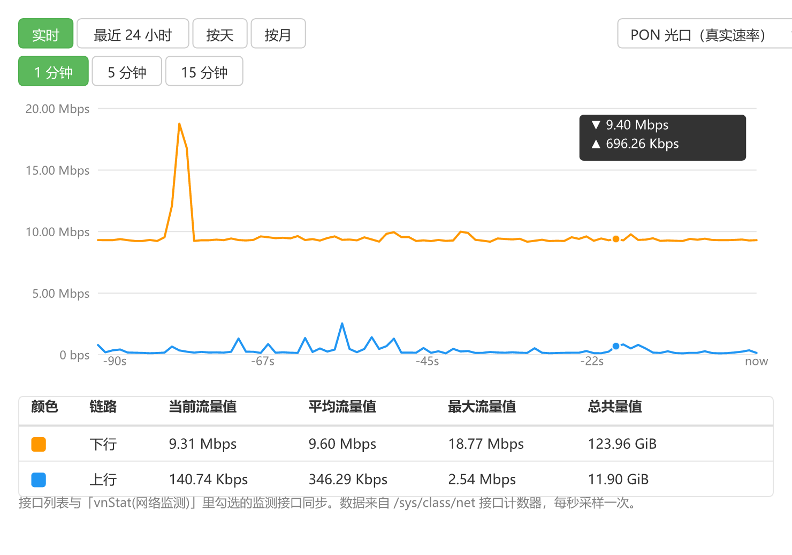
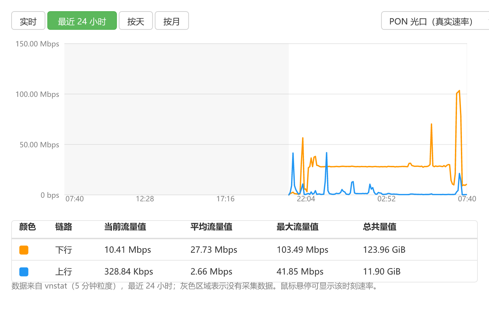

# luci-app-traffic

LuCI 流量统计页：实时速率折线图 + vnStat 历史图表，专为 **PON / OpenWrt 一体机**（如烽火 HG5585F）打造，普通 x86 / 路由器同样可用。

界面与交互**仿老毛子固件（Padavan）的流量统计风格**：橙色下行 / 蓝色上行双折线 + 悬停读数 + 下方速率汇总表，一眼就能看出当前链路吞吐。

## 效果预览

**实时速率** —— 每秒采样，峰值自动撑开纵轴，鼠标悬停显示该时刻读数：



**最近 24 小时** —— vnStat 5 分钟粒度历史，灰色区域表示该时段没有采集数据：



**按天 / 按月** —— 只给列表，不做图表：每天（每月）下行 / 上行 / 合计三列，按日期倒序，最新的排最上面。

## 功能

- **实时速率折线图**：浏览器端每秒采样 `/sys/class/net` 计数器绘制，鼠标悬停显示读数（与老毛子流量页同样式的双色折线）
- **动态纵轴**：刻度随当前峰值自动调整（1/1.5/2/2.5/3/4/5/6/8/10 × 10^n 档位），左侧留白自适应刻度文字宽度，不会出现 "100.00 Mbps" 被裁成 "00.00" 的情况
- **历史图表**：24 小时（5 分钟粒度）折线，采样中断处断线并涂灰，不会在缺口上拉一条假直线；按日/按月的列表按日期倒序，数据来自 vnStat，自动剔除建库基线假点
- **接口跟随 vnStat**：接口下拉只显示 `/etc/config/vnstat` 中勾选且有计数器的接口，勾选变化每秒自动同步
- **汇总表**：当前 / 平均 / 最大 / 总共量值（下行、上行各一行，带颜色标识）
- **默认接口智能选择**：优先 pon0（MAC/DMA 级计数，不受硬件加速转发影响），避免 pppoe-wan / br-lan 等软件接口在 flow offload 下的计数失真

## 依赖

- OpenWrt 21.02+（LuCI master，JS 视图）
- `luci-base`
- `vnstat2`（历史数据后端）

## 安装

### 方式一：作为普通 package 编译

```bash
# 克隆到 buildroot 的 package/ 目录
git clone https://github.com/shb110119/luci-app-traffic package/luci-app-traffic
make menuconfig   # 选中 LuCI -> Applications -> luci-app-traffic
make package/luci-app-traffic/compile V=s
```

### 方式二：克隆进 luci feed

```bash
git clone https://github.com/shb110119/luci-app-traffic feeds/luci/applications/luci-app-traffic
```

### 方式三：已有固件上直接装 ipk/apk

```bash
apk add ./luci-app-traffic_1.0.3-1_all.apk       # OpenWrt snapshot (apk)
opkg install ./luci-app-traffic_1.0.3-1_all.ipk  # 21.02/22.03/23.05 (opkg)
```

安装后进入 **状态 → 网络流量**。

## 注意事项

1. **vnStat 数据库持久化**：`/var/lib/vnstat` 是 tmpfs，重启即丢。本包自带 `98-vnstat-persist` uci-default 脚本，首次启动把库挪到 `/etc/vnstat` 并写进 sysupgrade 保留列表。
2. **MaxBandwidth**：`vnstat.conf` 默认 `MaxBandwidth 1000`（Mbit），2.5G PON 场景会报 "Traffic rate higher than set maximum" 导致不记账。脚本会自动改成 `2500`。
3. **硬件加速计数失真**：开启 `flow_offloading_hw` 时，pppoe-wan / br-lan 等软件接口只统计未被 PPE 加速的包，看 pon0 才是全量。接口标签里带"加速后偏小"提示的都属于这类。
4. **改 JS 要换文件名**：LuCI 前端用固定 URL 加载 JS 无版本号，浏览器缓存顽固，改 `overview.js` 内容时建议换名并同步 menu.d。
5. **24 小时图右侧突然空白**：多半是 vnstatd 卡住——进程还在，但库不再更新（`vnstat -i pon0` 顶部的 "Database updated" 停在几小时前），新数据自然画不出来。执行 `/etc/init.d/vnstat restart` 即可恢复；页面底部会同时给出"最后一条采样是 xx:xx"的提示。缺口是真实丢掉的采样，不会被补画。

## 文件结构

```
htdocs/luci-static/resources/view/traffic/overview.js      流量统计页前端
root/usr/share/rpcd/ucode/luci.traffic                      rpcd 后端（ucode）
root/usr/share/rpcd/acl.d/luci-app-traffic.json             ACL
root/usr/share/luci/menu.d/luci-app-traffic.json            菜单（状态 → 网络流量）
root/etc/uci-defaults/98-vnstat-persist                     vnStat 持久化
docs/screenshots/                                           效果预览图
```

## 致谢

- 交互与配色参考老毛子固件（Padavan）的流量统计页
- 后端数据来自 [vnStat](https://humdi.net/vnstat/)

## License

MIT
